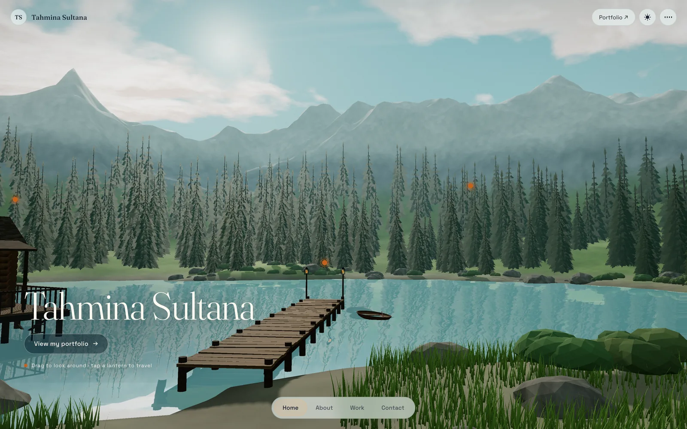
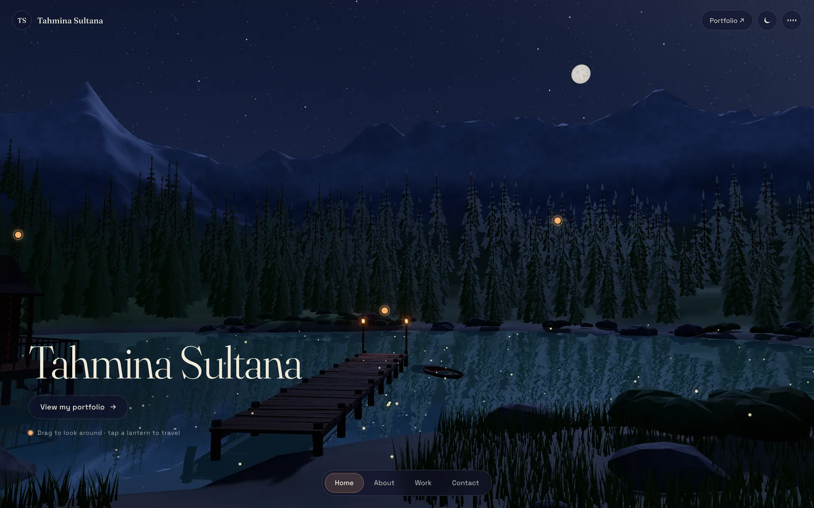
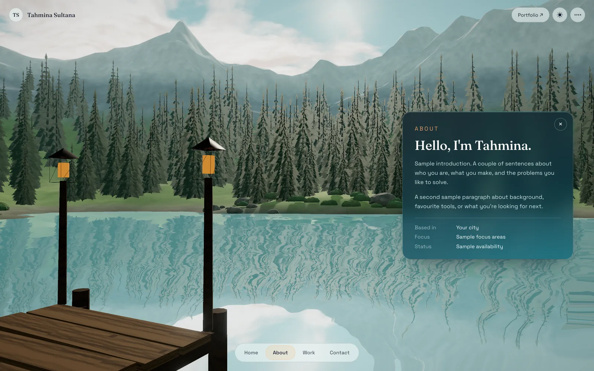
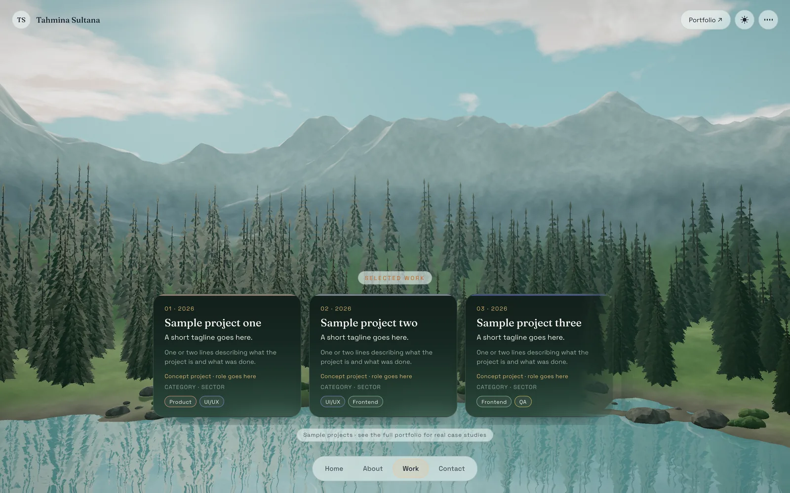
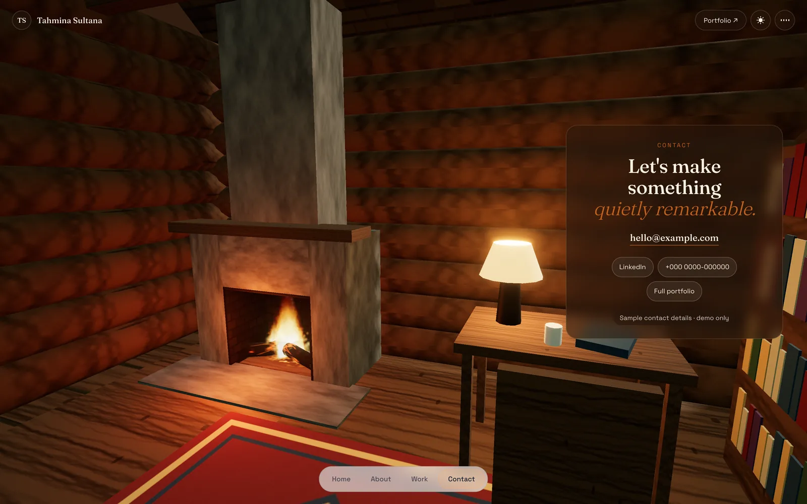

<div align="center">

# Lakeside

**A portfolio you can walk into.**

An interactive 3D mountain lake built with three.js. Every section of the site is a place you travel to.

[**Visit the live site →**](https://lakeside-portfolio.vercel.app) &nbsp;·&nbsp; [Case study](https://portfolio-tahmina5.vercel.app/work/lakeside) &nbsp;·&nbsp; [Main portfolio](https://portfolio-tahmina5.vercel.app)



</div>

## One world, two moods

| Day | Night |
|:---:|:---:|
|  |  |
| Teal sky, drifting cumulus, blue-teal haze over the peaks | Stars, a textured moon, lantern light, fireflies, and a lake that reflects them all |

## Every section is a place

| About, out on the dock | Work, over the forest | Contact, inside the house |
|:---:|:---:|:---:|
|  |  |  |

Clicking **Contact** walks you across the porch. The door swings open and you step into a room lit by a fire, where the contact card is waiting.

## What's inside

- **Gerstner waves.** Four overlapping wave trains with deep-water dispersion move the lake surface. The same wave function drives the rowboat's buoyancy, so it rides the waves you see.
- **One wind for everything.** A single wind field with a wandering direction and random gusts bends the grass in rolling bands, sways each spruce, builds the waves, leans the chimney smoke, and drives the wind sound.
- **A physics-driven fire.** Flame particles carry a temperature: hot ones rise, cool as they climb, and shift from white through orange to red. Sparks rise while hot, then fall back onto glowing coals. The firelight follows the fire's actual heat.
- **A lake house half on land, half on stilts.** Footings on the bank, stilts driven into the lakebed, a working door, an open window, and a furnished room.
- **Real reflections.** The water mirrors the forest, the mountains, the dock and the lanterns.
- **Built in code.** No 3D models and no photos. The terrain, trees, house, textures and sound are all generated in the browser.

## By the numbers

| | |
|---|---|
| **60 fps** | on laptop, phone and tablet, with 60,000 blades of grass moving in the wind |
| **1.6 s** | from tapping Contact to standing by the fire |
| **135 KB** | of hand-written code builds the whole world |

## Works on any device

- **Any screen shape.** The camera's field of view adapts, so phones in portrait still see the lake, the dock and the mountains.
- **Phones held sideways** get a compact layout.
- **Touch.** Finger-sized buttons, and spacing that keeps clear of notches and home bars.
- **Speed.** A frame-rate governor steps the resolution down when a device struggles and back up when it can.
- **Cheaper updates.** Reflections refresh every other frame, shadows update only when something moves, and the fire only simulates when you're near the house.

## Run it locally

Static files, with no build step and no dependencies to install:

```bash
git clone https://github.com/tahmina267/lakeside-portfolio.git
cd lakeside-portfolio
python3 -m http.server 5175
# open http://localhost:5175
```

three.js 0.160 loads from the jsDelivr CDN through an import map. Add `?hq` to the URL to render at full 2× resolution, which is useful for screenshots.

## Project structure

```
index.html   page shell, panels and navigation
style.css    layout, glass panels, day/night themes, responsive rules
world.js     the 3D world: terrain, water, forest, house, fire, wind, camera, sound
docs/        screenshots used in this README
```

## Deploy

Hosted on Vercel and connected to this repository: every push to `main` goes live automatically.

---

<div align="center">

Designed and built by **Tahmina Sultana** · [Portfolio](https://portfolio-tahmina5.vercel.app)

</div>
